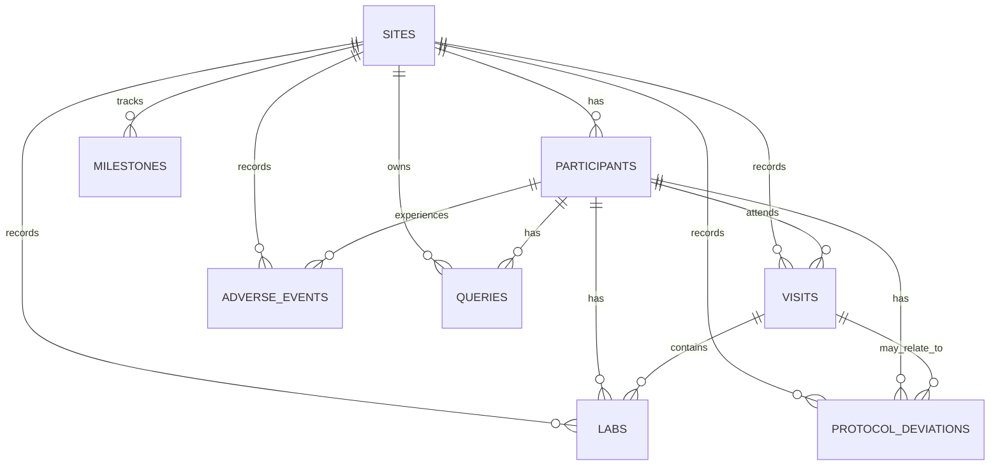

# Clinical informatics trial-operations demonstration

This project follows a small study-style protocol from requirements to reviewable operational outputs. It turns the protocol into linked tables, generates a deterministic synthetic snapshot, runs record-level checks, calculates site and study metrics and presents the results in reports and a Streamlit dashboard.

All people, sites, events and results are synthetic. The repository is a learning and demonstration project.

[Hosted dashboard](https://clinical-informatics.streamlit.app)

## Why this workflow

Clinical Operations decisions depend on data that can be traced back to the study requirements and the affected records. This workflow brings several related questions into one place:

- whether sites are progressing towards their illustrative enrolment targets;
- whether performed visits occurred within their protocol windows;
- which queries remain unresolved and how long they have been open;
- whether serious or ongoing adverse events need follow-up;
- where protocol deviations and data-quality issues are concentrated; and
- how each summary measure connects to a record-level issue.

The aim is to demonstrate the reasoning between a protocol, a relational data model and an operational review view.

## End-to-end workflow

1. Define a synthetic Phase II metabolic study scenario and schedule of assessments.
2. Map protocol requirements to data fields, relationships and validation questions.
3. Generate eight linked CSV tables with seed `42` and a data cut of `2026-06-30`.
4. Validate identifiers, parent-child relationships, eligibility timing, visit status, lab completeness, query ageing, adverse-event follow-up and milestone timing.
5. Produce record-level issues and study- and site-level operational metrics.
6. Write reproducible CSV, Markdown and figure outputs.
7. Recalculate the same checks and metrics after dashboard filters are applied.

The main components are Python, pandas, NumPy, pytest, Matplotlib, Plotly and Streamlit. GitHub Actions runs linting, behavioural tests, a coverage gate, the build and the relational practice workflow on Python 3.12.

## Relational model



The validation layer checks every relationship shown above, including agreement between repeated `site_id` and `participant_id` values. `queries.record_id` is intentionally a cross-table reference rather than a conventional single-table foreign key.

## Repository guide

- [`docs/protocol_to_data_mapping.md`](docs/protocol_to_data_mapping.md) records the protocol requirements, implementation status and known gaps.
- [`docs/relational_data_design.md`](docs/relational_data_design.md) defines keys, relationships and consistency rules.
- [`src/clinical_informatics/generate_synthetic_data.py`](src/clinical_informatics/generate_synthetic_data.py) creates the deterministic data snapshot.
- [`src/clinical_informatics/validation.py`](src/clinical_informatics/validation.py) produces record-level issues and a check summary.
- [`src/clinical_informatics/metrics.py`](src/clinical_informatics/metrics.py) derives operational measures from the same filtered records.
- [`src/clinical_informatics/reporting.py`](src/clinical_informatics/reporting.py) writes the data dictionary, reports, CSV outputs and figures.
- [`notebooks/relational_data_practice.py`](notebooks/relational_data_practice.py) demonstrates joins and grouped calculations as a plain Python script.
- [`app/streamlit_app.py`](app/streamlit_app.py) provides the interactive review views.
- [`METHODOLOGY.md`](METHODOLOGY.md) gives the calculation rules and implementation method.

## Run locally

The CI target is Python 3.12. Python 3.11 and 3.13 are also permitted by the package metadata.

```bash
python3 -m venv .venv
source .venv/bin/activate
python -m pip install -e ".[dev]"
python -m clinical_informatics.build_project --seed 42
python notebooks/relational_data_practice.py
pytest
streamlit run app/streamlit_app.py
```

The build writes the synthetic tables under `data/synthetic/` and derived material under `outputs/`. Use `--output-root <directory>` to run an isolated build without changing the repository outputs.

## What the dashboard shows

The dashboard has views for site progress, visit adherence, unresolved query burden and age, adverse events, missingness and validation issues. Site, participant-status and visit filters are applied to the raw tables first; metrics and validation outputs are then recalculated from that subset. An empty selection returns empty tables and zero metrics.

Two definitions when reading the figures:

- `open_query_n` includes both `Open` and `Answered` queries because neither state is operationally resolved until closure. The median age is calculated from exactly that subset.
- the visit-window miss rate uses performed visits (`Completed`, `Late` or `Early`) as its denominator. `Missed` and `Pending` visits are reported separately.

See [`METHODOLOGY.md`](METHODOLOGY.md) for the complete metric and threshold definitions.

## Scope and authorship

I built this as a First Class Biomedical Science graduate with experience working with governed hospital data and Python health-data workflows. I wanted a public, synthetic project I could take apart and explain properly.

I used AI-assisted coding tools during parts of the exploration, debugging and review. I remained responsible for the problem definition, retained implementation, tests, documentation, interpretation and final decisions. The repository is structured so those decisions can be inspected.
