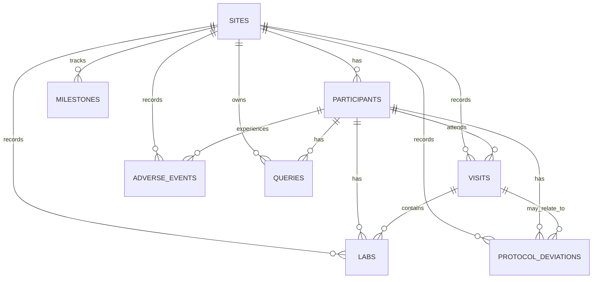

# Relational data design

## Entity overview

## Keys and relationships

| Table | Primary key | Foreign keys |
|---|---|---|
| `sites` | `site_id` | none |
| `participants` | `participant_id` | `site_id -> sites.site_id` |
| `visits` | `visit_id` | `participant_id -> participants.participant_id`; `site_id -> sites.site_id` |
| `labs` | `lab_id` | `visit_id -> visits.visit_id`; `participant_id -> participants.participant_id`; `site_id -> sites.site_id` |
| `adverse_events` | `ae_id` | `participant_id -> participants.participant_id`; `site_id -> sites.site_id` |
| `queries` | `query_id` | `participant_id -> participants.participant_id`; `site_id -> sites.site_id` |
| `protocol_deviations` | `deviation_id` | `participant_id -> participants.participant_id`; `site_id -> sites.site_id`; optional `related_visit_id -> visits.visit_id` |
| `milestones` | `milestone_id` | `site_id -> sites.site_id` |

Primary-key uniqueness is checked for all eight tables. The participant/visit-name pair is also unique so a participant cannot have two rows for the same scheduled visit.

## Repeated-key consistency

Several child tables repeat `site_id` and `participant_id` to make record-level review easier. A valid foreign key alone does not prove that the repeated values describe the same relationship. The validation layer therefore checks:

- visit site against participant site;
- lab participant and site against the related visit;
- lab site against participant site;
- adverse-event site against participant site;
- query site against participant site;
- protocol-deviation site against participant site; and
- protocol-deviation participant and site against the related visit when one is supplied.

Each failure produces its own check identifier and message.

## Deliberate non-relational reference

`queries.record_id` can refer to a visit, lab or adverse event depending on `queries.table_name`. A conventional foreign key cannot target several parent tables. The current project keeps this as an inspectable cross-table reference and does not claim database enforcement.

A production design could replace it with table-specific nullable keys, a common record registry or application-enforced polymorphic constraints. That extension is outside this CSV-based demonstration.

## Relational practice outputs

`notebooks/relational_data_practice.py` demonstrates:

- participants joined to sites for enrolment progress;
- visits joined to participant status for adherence;
- labs joined to visits so missingness is limited to performed visits;
- unresolved queries grouped by site and severity; and
- adverse events grouped by site, seriousness, severity and follow-up status.

The script writes compact CSV outputs under `outputs/` and an interpretation note that links summary measures back to their source tables.
